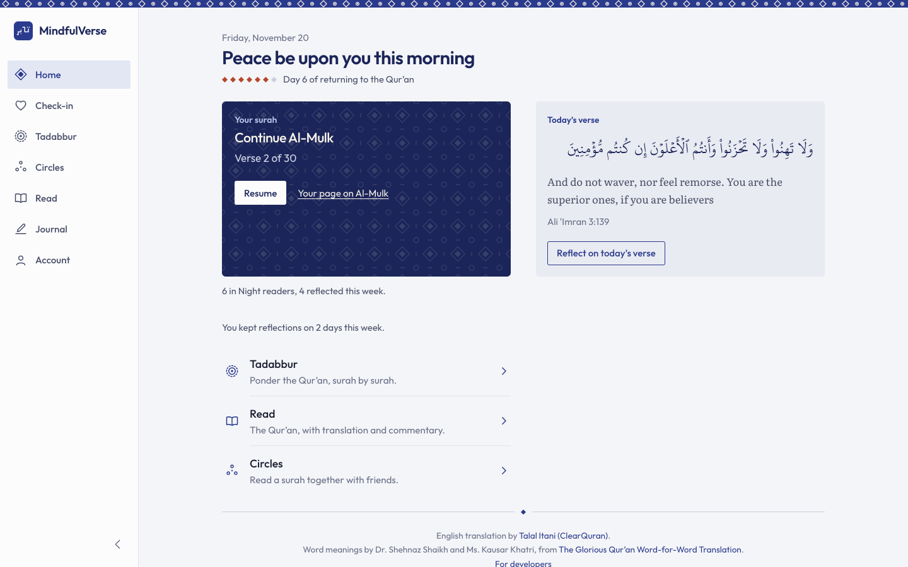
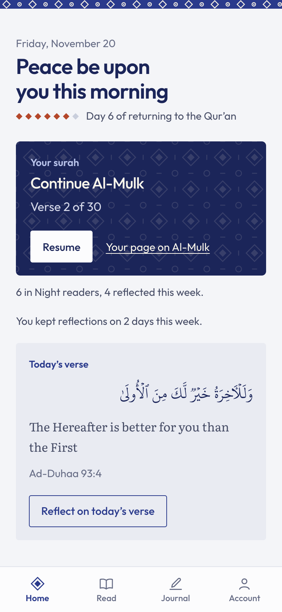
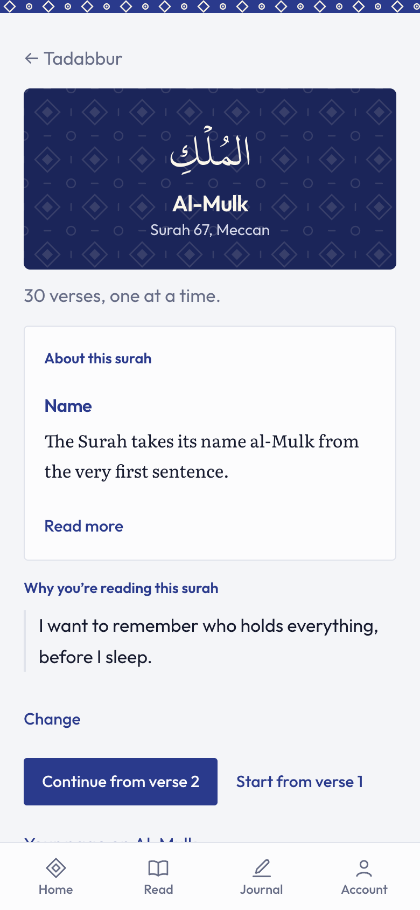
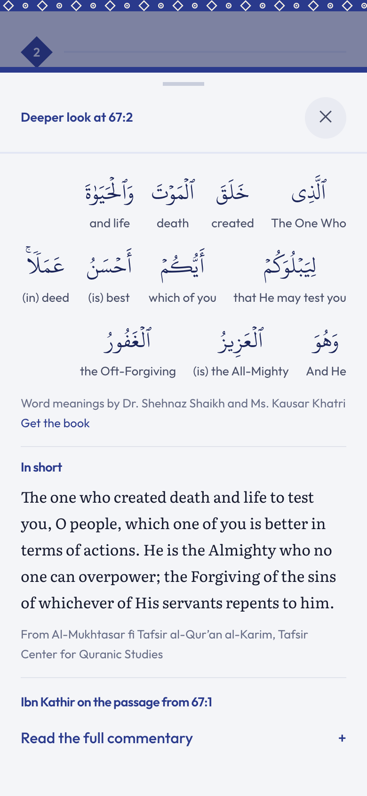
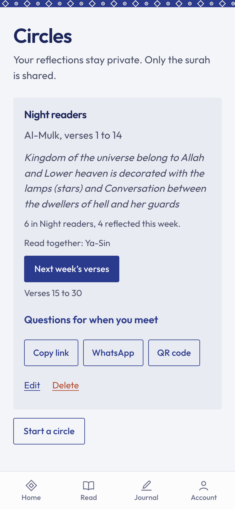
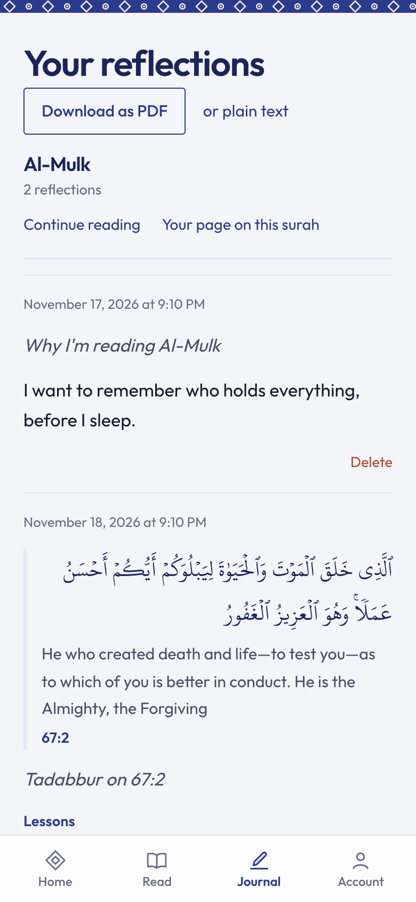
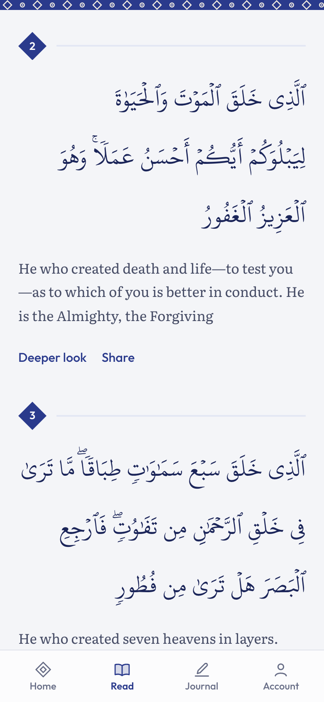

# MindfulVerse

A quiet app for pondering the Qur'an. Sit with one surah verse by verse, look deeper at any verse with its word meanings and a short explanation, keep a private journal, and get asked a week later whether you did what you wrote. Read a surah with friends in a circle, a few verses each week, each in your own words.

It works in the browser, on phones and on desktop, and as an Android app. It needs no sign up and works offline. It is free, with no ads.

Live at [mindfulverse.app](https://mindfulverse.app)

## Features

- **Surah journal.** Begin with a surah: its background, then verse by verse with Ibn Kathir, and a page that keeps everything you wrote on it.
- **Deeper look.** Under any verse: each Arabic word with its English meaning, "In short" (a short explanation from Al-Mukhtasar), other verses on the same subject, and Ibn Kathir's full commentary.
- **A week later.** Write what you will do; seven days on, Home asks how it went.
- **Circles.** Read a surah with friends, a few verses each week. Share a link, a WhatsApp message or a QR code; anyone can join without an account. The circle sees how many are reading and reflected this week, never who, plus questions for when you meet and the surahs read together. Be in up to three circles.
- **Tadabbur sessions.** Short guided reflections: a few verses on one theme.
- **Daily verse.** A verse for today and a place to write about it, with an optional daily reminder.
- **Read and search.** All 114 surahs with Arabic, English translation and commentary; search the translation or browse by theme.
- **Your rhythm.** Days of returning, and how many days this week you kept a reflection. Private, and it follows you across devices when you sign in.
- **Accounts and sync.** Optional sign in backs up your journal across devices.
- **For developers.** A free daily verse API for your own site, at `/developers`.

All Qur'an text, translation, and commentary are shown exactly as they are. The app never rewrites or generates religious content.

## Screenshots



| Home | A surah, verse by verse | Deeper look |
| --- | --- | --- |
|  |  |  |

| Circles | Your reflections | Reader |
| --- | --- | --- |
|  |  |  |

The screenshots use invented test data. To take them again, build and preview the web app, then run `node scripts/capture-readme.mjs`.

## Run it

The repo holds the web app, the Android app and the code they share. Run everything from the root folder:

```bash
npm install
npm run dev          # starts the web app on your computer
```

The Qur'an data the app needs is already in `apps/web/public/data`.

| Command | What it does |
| --- | --- |
| `npm test` | Runs all the tests |
| `npm run build` | Checks the shared code for type errors, then builds the web app into `apps/web/dist` |
| `npm run preview` | Serves the built web app |
| `npm run typecheck` | Checks the shared code for type errors |
| `npm run test:e2e` | Runs the browser test in `apps/web/e2e`. It is skipped unless `E2E_EMAIL` and `E2E_PASSWORD` are set |

Keep `.env` and `.env.local` in the root folder. The web app reads them from there.

For the Android app, see [`apps/mobile/README.md`](apps/mobile/README.md).

## How it is built

The web app uses React, TypeScript and Vite. A service worker lets it work offline. All the Qur'an data ships with the app, and your journal is saved in your browser first. The only server is an optional [InsForge](https://insforge.dev) backend, used for accounts, sync and reminders.

```text
packages/core/        code shared by web and Android: data, journal,
                      progress, circles, sync and accounts
apps/web/             the web app: pages, components and the service worker
apps/mobile/          the Android app, built with Expo
apps/promo/           the promo videos, made with Remotion from captures
                      of the running app
apps/web/public/data/ the Qur'an, translation, commentary, short
                      explanations, word meanings, themes and sessions
functions/            InsForge server functions (reminders, daily verse API)
migrations/           InsForge database changes
scripts/              build scripts for the app data, logo files and server
                      functions, the README screenshots, and retention.sql
                      for the launch numbers
```

The shared code never calls browser or phone features directly. Each app sets it up once when it starts, by calling `configureInsforge`, `configureData`, `configureSyncTriggers` and `configureAnalytics`.

The source datasets for `npm run build:data` are not in the repo. If some Qur'an data looks wrong, please open an issue.

## Acknowledgments

The Qur'anic datasets come from the [Quranic Universal Library](https://qul.tarteel.ai) by [Tarteel](https://tarteel.ai). This app would not exist without their work.

The English translation is [ClearQuran](https://www.clearquran.com) by Talal Itani, used under the CC BY-NC-ND 4.0 licence. The Arabic typeface is the KFGQPC Uthmanic Hafs script from the King Fahd Glorious Qur'an Printing Complex in Madinah.

The commentary is Tafsir Ibn Kathir (Abridged), the English edition published by Darussalam and abridged under the supervision of Shaykh Safiur-Rahman al-Mubarakpuri, as published in the Quranic Universal Library. Verses it quotes use that edition's own English rather than ClearQuran.

The short explanation of each verse is from the English edition of Al-Mukhtasar fi Tafsir al-Qur'an al-Karim by the Tafsir Center for Quranic Studies, shown unchanged.

The English word meanings are from [The Glorious Qur'an Word-for-Word Translation](https://amzn.to/3NVyXoB) by Dr. Shehnaz Shaikh and Ms. Kausar Khatri. They are shown exactly as the authors wrote them, with their kind permission for this free app. That permission is for MindfulVerse only, so please ask the authors before reusing them.

## Accounts and sync

You don't need to sign in. The whole app works signed out, offline, on your device. An account only backs up your journal and progress, so they follow you to another device. [InsForge](https://insforge.dev) provides sign in and the database. There is no other server.

| Setting | Used for |
| --- | --- |
| `VITE_INSFORGE_URL` | The address of the InsForge project |
| `VITE_INSFORGE_ANON_KEY` | The public key the app uses to talk to InsForge |
| `VITE_VAPID_PUBLIC_KEY` | The public key for the daily verse reminder in the browser |

For local work, put these in `.env` or `.env.local`. Copy `.env.example` to start. On Vercel, add all three under Project, Settings, Environment Variables, for both Production and Preview, then redeploy. Vite builds them into the app, so a change needs a new deploy.

Database changes are in `migrations/` and server functions are in `functions/`. You apply both to the InsForge project with the InsForge CLI. Nothing in this repo runs them for you.

How sync works:

- Everything is saved on the device first, so the app never waits for the network.
- When you sign in, come back online or return to the app, it fetches your saved journal and progress from your account.
- It joins them with what is on this device. Entries are matched by their id, and a deleted entry stays deleted. For progress, it keeps the furthest point you reached.
- It then sends back only what changed.
- Running sync twice, or on two devices at once, gives the same result. Nothing is duplicated or lost.

## Good to know

- The translation writes the divine name as "God". It is shown word for word, as its licence requires.
- Ibn Kathir wrote his commentary on passages, so some verses share a note with the verse next to them.
- Long verses show their first 12 words in Deeper look, with a button to show the rest.
- Recitation audio and more languages are planned for later. MindfulVerse is free, with no paid plan. See `ROADMAP.md`.

## Licence

The code is under the [MIT License](LICENSE). The Qur'anic text, translation, commentary and fonts keep their own licences. See [LICENSE](LICENSE) and the Acknowledgments above. Want to help? See [CONTRIBUTING.md](CONTRIBUTING.md).
